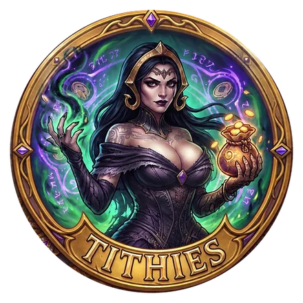

# Tithies

A toolbox for Magic: The Gathering collectors: a Chrome extension (MV3) that adds tools around your [Moxfield](https://moxfield.com) collection and decks, and connects them to shops such as [Face to Face Games](https://facetofacegames.com) (F2F). Each tool is a feature below; more are added over time.

**Install:** download it and follow the 5-step guide on **https://tithies.github.io/** (Chrome, Edge, Brave; not on the Chrome Web Store).

## Accounts

Tithies keeps each Moxfield account apart: its Selling runs, synced decks, collection and Comparator options belong to it, and every page shows one account, picked at the top right of the dashboard (with the site's icon, and a green dot when it is logged in on Moxfield right now). Settings are shared by every account.

- **Accounts are added by an action**, never just because a Moxfield tab is open: "Check selling prices" in the Moxfield panel, an initial sync, or "Add without syncing". An action started from Moxfield runs as the account logged in there and switches the dashboard to it.
- **Initial sync.** When Tithies meets an account whose decks and collection it has never read (logged in on Moxfield but not in Tithies yet, added by a selling check, or no account at all), the header shows an **Initial sync** button. Its prompt reads the deck list, every deck and the whole collection; **Not now** stops offering it for that account (Settings → Accounts still has it, in its *Synced* column). The account menu's "Use …" and "Switch Tithies to …" for an account Tithies doesn't know open the same prompt, and so does the note in the Moxfield panel (checking selling prices never needs it).
- **One login per site at a time.** The browser holds one Moxfield login, so other accounts stay viewable from what Tithies already read, but only the logged-in account can be synced. Syncing an account while Moxfield is logged in as another one stops before anything is read, with a button to switch Tithies to the logged-in account instead. If the login changes in the middle of a sync, the sync stops at the first answer from the other account: what was read before is kept, and nothing is written into (or deleted from) the wrong account.
- **Settings → Accounts** gives each account a nickname, and **Forget** deletes everything Tithies keeps for it, the log of the changes it made to that account included (its running checks, syncs and exports are stopped first). Nothing on Moxfield is touched.
- **Updating from a version before accounts** resets the Selling runs and the synced decks and collection (they had no owner); the F2F caches and settings are kept. After installing or updating Tithies, reload your open Moxfield tabs so Tithies sees which account is logged in there.
- Tithies learns the account from Moxfield's session token itself (its user id and username claims), in the page. The token never leaves the page; only the user id and username are kept, in this browser.

The code is ready for other sites like Moxfield (account types): each lives in `src/lib/sites/<type>/` with a provider in `src/lib/sites/registry.ts`, and its own content scripts.

## Feature 1 — Selling: what F2F pays for your cards

1. Open **moxfield.com/collection** and apply any filters you want (set, rarity, search…).
2. In the **Tithies** panel (bottom-right), click **Check selling prices on F2F**.
3. Tithies reads exactly the cards in that filtered view (non-proxy only, every language), as the account shown in the panel ("As …"). It then looks up each exact print on F2F: same set, collector number, finish and language, NM condition.
4. Open the dashboard (toolbar icon, or **Open results** in the panel) to see:
   - every card, with an image, quantity, F2F buy price (cash and +30 % store credit), F2F retail price, and **buy ÷ sell %** for cash and for credit;
   - a coloured icon: **green cash = F2F buys it**, **orange box = bulk** (F2F doesn't buy it, so it's valued at the [wholesale bulk](https://facetofacegames.com/collections/wholesale-bulk?site=sell) rate). A red dot means the match needs review;
   - panels above the table: **F2F buys** and **Bulk** (prints, copies, what you get in cash and credit, and *% of F2F*: your total ÷ F2F's own price for those cards; click one to show only those cards), their **Total**, with each one's share of what you get, the **buy ÷ sell % per card** (median and average, for F2F buys, bulk and both) and **Needs review**;
   - **Buy** (F2F shop page) and **Sell** (F2F sell page, or the bulk page) links for each card;
   - filters (name, category, set, finish, rarity, match, price / % ranges, stock), sorting on every column, a page-size selector (default 100) and CSV export; every column is shown until you hide some (**Columns**);
   - **Cards in decks** (under **Filters**): *Hide copies used in decks* keeps only the copies no deck uses, to see what you can sell without taking a card out of a deck. Pick the decks (the same folder tree as the Comparator) and the boards that count (maybeboard off by default); deck proxies never count, since they use no copy of your collection. Prints are compared as on the Comparator (set, collector number, finish and the print's language). A print some decks use keeps its free copies (*1 of 3* in the Qty column; hover it for the decks), a print whose copies are all in decks is left out, and the cards above the table count only the copies kept. Copies are counted against your whole synced collection, not only the run's, so a run read from one binder keeps a copy when the deck's copy is another one (with no collection read yet, only the run's copies are known). It needs your decks synced (its own **Sync decks and collection** button). The options are saved per account, for every run, apart from the Comparator's; **Reset** turns it off and keeps the deck choices;
   - the history of every run of the current account.

**The whole collection, from the dashboard.** **Check whole collection** (top right of *Selling → Runs*; before the first run, the page offers it next to the Moxfield panel's way) checks every paper, non-proxy card of the current account (MTGO and Arena rows are left out), without opening Moxfield's collection page. The run shows up at once and first reads the collection in the background, like the Comparator does (only what changed since Tithies' last read when that can be trusted, else every page; the decks aren't read), into the same collection snapshot; it then checks its cards like any other run. Moxfield must be logged in as that account in this browser; with no account in Tithies yet, the logged-in one is added. A run whose read fails or is cancelled ends without cards (check again); one whose read was cut by a browser restart ends too.

**Languages.** Each card is checked in the language its Moxfield entry's *Language* field says, and only in that language: F2F buys a copy as listed in its language. F2F lists almost every print in English only. It lists other languages mostly for prints that exist in one language, often in sets of their own ("Foreign Black Border: French", "Renaissance German", "Fourth Edition Black Border: Japanese"), which Tithies matches to Moxfield's set ("Foreign Black Border"). A card F2F doesn't list in its language is **not bought** ($0, "F2F doesn't list this print in French"), and so is one F2F lists but doesn't buy: F2F's bulk lots are English, so other languages are never valued at bulk rates. Non-English cards have a language badge (FR, JA…), and there's a Language filter.

Moxfield keeps two languages per collection card: the print's (Moxfield has one card for each print *and* language, image and printed name included, e.g. a French MH2 #68 Suspend) and the entry's *Language* field, which defaults to English and is never checked against the print. Tithies trusts the Language field and shows a yellow warning when the print is in another language, e.g. an FBB #41 Swords to Plowshares (a French print) left on "English" is checked in English.

Runs are stored in IndexedDB and survive browser restarts. A run interrupted by a crash, a restart or F2F rate limiting resumes from the next unfinished batch (once it has its cards).

### How it talks to the sites

- **Moxfield.** A small script in the Moxfield page remembers the collection-search request the page itself makes (`api2.moxfield.com/v1/collections/search?...`). That request already carries your filters and session, and Tithies replays it page by page. Your session token never leaves the page.
- **Moxfield decks (feature 2).** The background worker asks a logged-in Moxfield tab to make each request. Your own tab is used if one is open; otherwise Tithies opens one, shows it for a few seconds while Moxfield starts (Moxfield doesn't start in a never-shown tab), then switches back and closes it at the end. The page makes the request with its own session and sends back only trimmed card lists, never the token. Requests: `GET /v3/decks` (the whole deck list), `GET /v1/deck-folders` (every folder, for the links to them: Moxfield answers 100 per page), `GET /v3/decks/all/{publicId}` per new or changed deck, and the unfiltered collection search, 100 rows per page (Moxfield answers 100 whatever is asked since November 2026; there is no setting for it any more).
  - **Reading only what changed.** Moxfield's collection search can list entries most recently changed first (`sortType=lastUpdated`). Compare, and the export's collection reads, read those pages until they reach entries older than Tithies' snapshot (with a 5-minute overlap), usually **1 request** instead of 40 for 4,000 entries. Moxfield's totals over the whole collection (entries and copies) then tell whether anything else happened, such as a deletion, which no listing shows; if they don't match, every page is read. Every page is also read the first time, when the last full read is a week old, or with **Read every page** on the Comparator page. An edit Moxfield made without changing an entry's time (none is known) would be seen at the next full read.
  - **Pace:** one request at a time, 1–1.5 s apart (**Settings → Moxfield**).
  - **Rate limits:** Moxfield sends no `Retry-After`, and its own UI says to wait about 30 s. On HTTP 429 Tithies waits 30 s, 60 s, then 120 s, and stops after that.
  - **Interruptions:** each deck is saved as soon as it's read, so an interrupted sync continues where it stopped.
  - **Accounts:** every request carries the account it must be made as; the page refuses to send it as anyone else, and every answer says who it was made as (see Accounts above).
  - **Permission:** Moxfield's API is private. Its FAQ says they sometimes allow personal, non-commercial use on request (support@moxfield.com).
- **F2F.** Tithies uses the same public search endpoint as F2F's "sell your cards" mode (`/apps/prod-indexer/buy/search/...`). Each product variant includes both `price` (what F2F sells it for) and `sellPrice` (what F2F pays you). Up to 40 prints are looked up per request (name × collector number, one language per request). Requests go one at a time, at least 1.5 s apart plus random jitter. Tithies honours `Retry-After` on HTTP 429 and pauses after 3 failures in a row. Results are cached for 1 h (setting); "not found" results are always looked up again.
- **Moxfield writes (exports only).** Tithies changes Moxfield only when you confirm an export, and only through these requests (each one in the change log, exactly as sent): `POST /v1/trade-binders` (create a binder), `POST /v1/collections/bulk/remove` (delete entries, up to 1000 per request), `DELETE /v1/collections` (a collection replace), `POST /v1/collections/import-file` (Moxfield's own CSV import, 500 rows per request, into a binder with `tradeBinderId`), and `POST /v1/collections` (one card by its card id, for prints in another language than English). They are made by the page like the reads, and only as the account you picked: the page refuses to send them as anyone else. **A write is never sent twice**: when its outcome is unknown (timeout, lost tab, network or server error) the export stops, and the collection is read again to show what was made. Only refusals (HTTP 429, a wrong account before sending) are retried.
- **Shop/sell mode.** F2F keeps a cart attribute `site=shop|sell`. Sell links use F2F's own `?site=sell`. Buy links use `?tithies=shop`, which a tiny content script turns back into shop mode.

The F2F delays, the batch size, the cache TTL, the credit bonus and the fallback search can be changed under **Settings → Selling**, and the Moxfield pace under **Settings → Moxfield** (saved as you type). **Settings → Stored data** shows everything Tithies keeps in the browser (the shared F2F lookups and the change log, then each account's synced decks, collection and runs) and clears any part of it, or all of it; **Reset settings** puts every setting and preference back to its default; **Remove all data** stops whatever runs, then removes everything (every account and its data, the caches, the change log, every setting), as after a fresh install.

## Feature 2 — Comparator

Normally every card in your decks is also in your collection, and every collection card sits in a deck. **Collection → Comparator** in the dashboard lists every exact print (set, collector number and finish) where the two disagree, with quantities:

- **Missing from collection**: copies your decks use that the collection doesn't have;
- **Not in any deck**: collection copies no included deck uses.

Each list is shown or hidden by clicking its panel above the table, since not everyone mirrors both ways. A third panel, **Matching**, shows the copies that are both in decks and in the collection (hidden by default). Every copy is in exactly one of the three: a print that only partly matches has two rows, e.g. Plains M20 #263 with 13 in decks and 21 owned is *Match 13* and *Not in a deck +8*. The **Copies** column is each row's own copies (−missing, +in no deck, or matching); *In decks* and *In collection* are the print's totals. Copies of a print used by several decks add up (each physical copy is expected to live in one deck). Every condition of a collection print counts. Languages are compared: a print is its set, collector number, finish *and* the language of Moxfield's card for it (decks point to one, e.g. a deck's French Talisman of Hierarchy is the French MH1 #233). Deck cards have no Language field, so a collection copy is compared by its print even when its Language field says another language; such rows show a yellow warning. A print used in one language and owned in another gets the same yellow hint as another finish. MTGO/Arena collection rows are ignored.

1. The first time, run the initial sync (the header's **Initial sync** button, or **Sync decks and collection** on the page). Tithies reads your deck list, then every deck (about 6 minutes for ~270 decks), then your whole collection, and keeps them in the extension: the comparison shows right after.
2. Pick the decks to compare in the folder tree (Moxfield folders, with tri-state folder checkboxes and search). Each deck and folder shows its card count (a folder's: every deck below it) and a link to it on Moxfield; the list scrolls past a few hundred pixels. Choices are saved, per account. They're stored as exclusions, so **new decks are included automatically** and marked *New*.
3. Choose the boards that count (maybeboard off by default) and whether to **ignore proxies** (on by default, both sides).
4. Click **Compare**. It syncs decks again (1 request for the list plus 1 per new or changed deck, compared on Moxfield's last-updated time), then reads what changed in your collection (every page the first time, once a week, after a deletion, or with **Read every page**). The line above the buttons says how the last read went. Options apply instantly afterwards, without new requests.

The options (decks and folders left out, boards, proxies, which rows are shown) are saved as you change them, per account; **Reset settings** puts them back to their defaults.

Rows show which decks use the print. A yellow hint flags the likely fix when the same card differs the other way in another print or finish (e.g. the deck says foil, the collection has non-foil); when decks use that other print, the hint links them, since that is where to fix it. Filters, sort and CSV export work like the F2F results table.

### Exporting to Moxfield

The rows of a comparison can be exported to a Moxfield account, as a binder or into its collection (e.g. the cards your decks miss into a "To buy" binder of another account).

1. **Choose what to export.** Each row has an export button (copies = the row's copies; change the quantity in the row or in the review drawer). Both rows of a print can be added: they are exported as one print with all their copies. The **Export** menu adds every row shown (all pages), every "Missing from collection", "Not in any deck" or "Matching" row, removes the rows shown, or clears the export. The list only lives on the page: leaving it asks first.
2. **Export to Moxfield…** (the bar at the bottom) opens four steps:
   - **Target**: the Moxfield account (another one than the compared account by default), then a **new binder** (name, visibility), an **existing binder** or the **collection**, each with **Add** (keep what's there) or **Replace** (delete what's there first). It must be the account logged in on Moxfield in this browser.
   - **Preview** (nothing is changed yet): everything that would change, read live: what would be created, deleted (every entry) and added, the copies before → after, the requests and how long they would take, and warnings. Binder cards are collection cards on Moxfield: replacing a binder deletes its cards from the collection; replacing the collection deletes every card, binders included.
   - **Confirm**: a checkbox; for a replace, type the binder name (or the username, for the collection); for the compared account itself, a second explanation (the exported cards become part of the collection you compare: missing cards stop being missing, cards in no deck are then there twice).
   - **Progress**: Tithies reads the target again and stops if it changed since the preview, makes the changes, then reads the collection again and **checks every copy** per print: "all 57 copies are there, and nothing else changed", or the prints short, extra (a card imported as another print shows up as one short and one extra) or otherwise changed.
3. Cards are added Near Mint, each in its language, with their exact set, collector number and finish. The language is the one the copies' Language field says ("Missing from collection" rows only exist in decks: the print's language). When a print's copies have several Language fields and decks use only some of them, the export assumes decks use the copies in the print's language, and the item says so. Each card keeps its exact print too: Moxfield's CSV import picks the English print of a set and number whatever the Language column says, so a print in another language (a French MH2 #68 Suspend) is added on its own, by its Moxfield card id (`POST /v1/collections`, as Moxfield's own "add to collection" does; one request per print). The check after the export compares the Language field and the print's language. The export list stays after an export (to try again); clear it from the last step.

**Requests, step by step.** Each step reads only what it needs (Moxfield answers 100 rows per page, at your Moxfield pace):

| Target | Target step | Preview | Before the changes | Changes | Check |
|---|---|---|---|---|---|
| New binder | binder list (1) | nothing more | binder list (1) | create binder, import(s) | binder list + the binder's pages |
| Existing binder, add or replace | binder list (1) | the binder's pages | binder list + the binder's pages | (replace: bulk remove) + import(s) | binder list + the binder's pages |
| Collection, add | binder list (1) | 1 page (its size) | binder list + its changes since the last snapshot (every page without a recent one) | import(s) | binder list + the changes since "before" (the new entries) |
| Collection, replace | binder list (1) | its changes since the last snapshot (every page without one) | binder list + the same | delete collection + import(s) | binder list + the new collection's pages |

A binder is read with Moxfield's own binder search (`/v1/trade-binders/{publicId}/search`); if that fails, Tithies reads the whole collection instead and keeps that binder's cards. Every read shows its progress (page *n* of *m*, %).

The export is reusable by other pages: `src/lib/export/` (export list, dialog, plan, check, background job) with each site's writes in `src/lib/sites/<type>/export.ts`. One Moxfield job runs at a time: a sync waits for an export and the other way round.

## Change log

**Change log** (above Settings) lists everything Tithies changed on your sites, newest first, for every account: each action (an export…), its status, and every request it sent, exactly as sent (method, URL, body or CSV, status, the start of the answer, duration; sessions and tokens are never logged). An action stopped by a browser restart shows as *interrupted* and is never resumed; a request without an answer shows as *unknown*. For an export it also shows the check, and keeps the entries it deleted with a **CSV to import them back** on Moxfield (Moxfield has no undo). Download any action as JSON. Every write goes through one logged path (`SiteClient.mutate`), so future features' changes are logged the same way. Clear the log in **Settings → Stored data**.

The deck sync lives in `src/lib/decks/` (sync, cache, folder tree, deck picker) so other features can reuse it.

## Development

Requires Node ≥ 22.12 (`.nvmrc` pins 24).

```bash
nvm use            # Node 24
npm install
npm test           # Vitest (unit + runner integration tests on real F2F/Moxfield fixtures)
npm run typecheck
npm run build      # -> .output/chrome-mv3
npm run build:win  # build + copy to C:\Users\<you>\tithies-ext (set TITHIES_WIN_DIR to change)
```

Load it in Chrome: `chrome://extensions` → enable **Developer mode** → **Load unpacked** → pick the build folder. After rebuilding, click the reload ↻ icon on the extension card.

### Releasing (GitHub Pages)

Every push to `master` runs `.github/workflows/pages.yml`: typecheck, tests, `npm run site`, then deploy to GitHub Pages. The site is the download page in `site/`, plus `tithies.zip`, `tithies-<version>.zip` and `version.json`.

- **To release:** just push to `master`. The version is automatic (`scripts/version.mjs`): `<major>.<minor>` from `package.json` plus the number of commits that changed the extension (`src/`, `public/`, `wxt.config.ts`, dependencies). Pushes that only touch the README, tests or `site/` keep the version, so they refresh the page without announcing an update. Bump `major`/`minor` in `package.json` by hand for big changes. The dashboard reads `version.json` at most every 6 hours (or when you click "Update checked … ago" in its header) and shows a "new version available" banner when it's newer than the installed version.
- **One-time setup:** the repository is `tithies/tithies.github.io` (a free GitHub organization; that repository name puts the page at the domain root). In the repository, go to **Settings → Pages → Source** and pick **GitHub Actions**.
- **Preview locally:** `npm run site` builds the site into `site-dist/`.
- **Fixed extension ID:** the manifest `key` (in `wxt.config.ts`) pins the ID to `cihnokdnhnhjamllchdmnehblkekcjbj` wherever the folder lives. That's what lets users update by replacing files without losing data. The matching private key is kept outside the repo, and is only needed to pack a `.crx` or publish to a store.

### Layout

```
src/entrypoints/          background worker, content scripts (Moxfield hook + panel, F2F mode helper), dashboard page
src/features/f2f-buylist/ runner (batches, cache, resume), matcher, bulk rates, dashboard UI
src/features/collection-comparison/ deck ↔ collection comparison, options, comparison page
src/features/change-log/  Change log page: every change made to a site, request by request
src/features/settings/    Settings page: accounts, Moxfield pace, stored data, reset
src/lib/accounts/         accounts, the current account, and the access layer: the only code that touches per-account data
src/lib/cards/            site-neutral card types (collection entries, prints)
src/lib/decks/            reusable deck sync + cache, collection snapshot, background job, folder tree, deck picker
src/lib/export/           reusable export to a site: page export list, dialog, plan + check, background job
src/lib/changes/          the change log (every write, by action)
src/lib/sites/            site providers (account types) + registry, polite client, tab transport, live sessions
src/lib/sites/moxfield/   Moxfield: API requests, normalisation, session/account in the page, provider
src/lib/                  F2F API client, Dexie DB, settings, messaging, update check, shared UI/format/sort helpers
site/                     download page (GitHub Pages); scripts/build-site.mjs fills it in and adds the zip + version.json
tests/                    Vitest specs + trimmed real API fixtures
```

New features go in `src/features/<name>/` and add a section to the dashboard navbar (`src/entrypoints/dashboard/Layout.tsx`). Per-account data goes through `accountData(key)` (`src/lib/accounts/data.ts`): a test fails if anything else reads or writes the per-account tables.

Stack: [WXT](https://wxt.dev), React 19, [Mantine 9](https://mantine.dev) (dark theme) + [mantine-datatable](https://icflorescu.github.io/mantine-datatable/), Dexie, ky, p-queue, zod, PapaParse.
