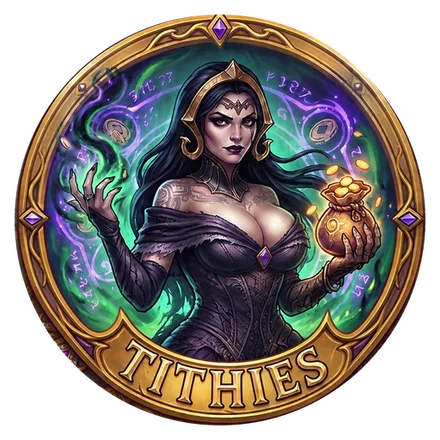

# Tithies

A toolbox for Magic: The Gathering collectors: a Chrome extension (MV3) that adds tools around your [Moxfield](https://moxfield.com) collection and decks, and connects them to shops such as [Face to Face Games](https://facetofacegames.com) (F2F). Each tool is a feature below; more are added over time.

**Install:** download it and follow the 5-step guide on **https://tithies.github.io/** (Chrome, Edge, Brave; not on the Chrome Web Store).

## Accounts

Tithies keeps each Moxfield account apart: its Selling runs, synced decks, collection and Mismatches options belong to it, and every page shows one account, picked at the top right of the dashboard (with the site's icon, and a green dot when it is logged in on Moxfield right now). Settings are shared by every account.

- **Accounts are added by an action**, never just because a Moxfield tab is open: "Check selling prices" in the Moxfield panel, a first "Sync decks", or "Switch Tithies to …". An action started from Moxfield runs as the account logged in there and switches the dashboard to it.
- **One login per site at a time.** The browser holds one Moxfield login, so other accounts stay viewable from what Tithies already read, but only the logged-in account can be synced. Syncing an account while Moxfield is logged in as another one stops before anything is read, with a button to switch Tithies to the logged-in account instead. If the login changes in the middle of a sync, the sync stops at the first answer from the other account: what was read before is kept, and nothing is written into (or deleted from) the wrong account.
- **Settings → Accounts** gives each account a nickname, and **Forget** deletes everything Tithies keeps for it (its running checks and syncs are stopped first). Nothing on Moxfield is touched.
- **Updating from a version before accounts** resets the Selling runs and the synced decks and collection (they had no owner); the F2F caches and settings are kept. After installing or updating Tithies, reload your open Moxfield tabs so Tithies sees which account is logged in there.
- Tithies learns the account from Moxfield's session token itself (its user id and username claims), in the page. The token never leaves the page; only the user id and username are kept, in this browser.

The code is ready for other sites like Moxfield (account types): each lives in `src/lib/sites/<type>/` with a provider in `src/lib/sites/registry.ts`, and its own content scripts.

## Feature 1 — Selling: what F2F pays for your cards

1. Open **moxfield.com/collection** and apply any filters you want (set, rarity, search…).
2. In the **Tithies** panel (bottom-right), click **Check selling prices on F2F**.
3. Tithies reads exactly the cards in that filtered view (English, non-proxy only), as the account shown in the panel ("As …"). It then looks up each exact print on F2F: same set, collector number and finish, NM condition.
4. Open the dashboard (toolbar icon, or **Open results** in the panel) to see:
   - every card, with an image, quantity, F2F buy price (cash and +30 % store credit), F2F retail price, and **buy ÷ sell %** for cash and for credit;
   - a coloured icon: **green cash = F2F buys it**, **orange box = bulk** (F2F doesn't buy it, so it's valued at the [wholesale bulk](https://facetofacegames.com/collections/wholesale-bulk?site=sell) rate). A red dot means the match needs review;
   - **Buy** (F2F shop page) and **Sell** (F2F sell page, or the bulk page) links for each card;
   - filters (name, category, set, finish, rarity, match, price / % ranges, stock), sorting on every column, a page-size selector (default 100) and CSV export;
   - the history of every run of the current account.

Runs are stored in IndexedDB and survive browser restarts. A run interrupted by a crash, a restart or F2F rate limiting resumes from the next unfinished batch.

### How it talks to the sites

- **Moxfield.** A small script in the Moxfield page remembers the collection-search request the page itself makes (`api2.moxfield.com/v1/collections/search?...`). That request already carries your filters and session, and Tithies replays it page by page. Your session token never leaves the page.
- **Moxfield decks (feature 2).** The background worker asks a logged-in Moxfield tab to make each request. Your own tab is used if one is open; otherwise Tithies opens one, shows it for a few seconds while Moxfield starts (Moxfield doesn't start in a never-shown tab), then switches back and closes it at the end. The page makes the request with its own session and sends back only trimmed card lists, never the token. Requests: `GET /v3/decks` (the whole deck list), `GET /v3/decks/all/{publicId}` per new or changed deck, and the unfiltered collection search (5000 rows per page).
  - **Pace:** one request at a time, 1–1.5 s apart (**Settings → Moxfield**).
  - **Rate limits:** Moxfield sends no `Retry-After`, and its own UI says to wait about 30 s. On HTTP 429 Tithies waits 30 s, 60 s, then 120 s, and stops after that.
  - **Interruptions:** each deck is saved as soon as it's read, so an interrupted sync continues where it stopped.
  - **Accounts:** every request carries the account it must be made as; the page refuses to send it as anyone else, and every answer says who it was made as (see Accounts above).
  - **Permission:** Moxfield's API is private. Its FAQ says they sometimes allow personal, non-commercial use on request (support@moxfield.com).
- **F2F.** Tithies uses the same public search endpoint as F2F's "sell your cards" mode (`/apps/prod-indexer/buy/search/...`). Each product variant includes both `price` (what F2F sells it for) and `sellPrice` (what F2F pays you). Up to 40 prints are looked up per request (name × collector number × English). Requests go one at a time, at least 1.5 s apart plus random jitter. Tithies honours `Retry-After` on HTTP 429 and pauses after 3 failures in a row. Results are cached for 1 h (setting); "not found" results are always looked up again.
- **Shop/sell mode.** F2F keeps a cart attribute `site=shop|sell`. Sell links use F2F's own `?site=sell`. Buy links use `?tithies=shop`, which a tiny content script turns back into shop mode.

The F2F delays, the batch size, the cache TTL, the credit bonus and the fallback search can be changed under **Settings → Selling**, and the Moxfield pace under **Settings → Moxfield** (saved as you type). **Settings → Stored data** shows everything Tithies keeps in the browser (the shared F2F lookups, then each account's synced decks, collection and runs) and clears any part of it, or all of it; **Reset settings** puts every setting and preference back to its default.

## Feature 2 — Deck ↔ collection mismatches

Normally every card in your decks is also in your collection, and every collection card sits in a deck. **Decks → Mismatches** in the dashboard lists every exact print (set, collector number and finish) where the two disagree, with quantities:

- **Missing from collection**: copies your decks use that the collection doesn't have;
- **Not in any deck**: collection copies no included deck uses.

Each list has its own checkbox, since not everyone mirrors both ways. Copies of a print used by several decks add up (each physical copy is expected to live in one deck). Every language and condition of a collection print counts. MTGO/Arena collection rows are ignored.

1. The first time, click **Sync decks**. Tithies reads your deck list, then every deck (about 6 minutes for ~270 decks), and keeps them in the extension.
2. Pick the decks to compare in the folder tree (Moxfield folders, with tri-state folder checkboxes and search). Choices are saved, per account. They're stored as exclusions, so **new decks are included automatically** and marked *New*.
3. Choose the boards that count (maybeboard off by default) and whether to **ignore proxies** (on by default, both sides).
4. Click **Find mismatches**. It syncs decks again (1 request for the list plus 1 per new or changed deck, compared on Moxfield's last-updated time), then reads your whole collection. Options apply instantly afterwards, without new requests.

Rows show which decks use the print. A yellow hint flags the likely fix when the same card is mismatched the other way in another print or finish (e.g. the deck says foil, the collection has non-foil). Filters, sort and CSV export work like the F2F results table.

The deck sync lives in `src/lib/decks/` (sync, cache, folder tree, deck picker) so other features can reuse it.

## Development

Requires Node ≥ 22.12 (`.nvmrc` pins 24).

```bash
nvm use            # Node 24
npm install
npm test           # Vitest (unit + runner integration tests on real F2F/Moxfield fixtures)
npm run typecheck
npm run build      # -> .output/chrome-mv3
npm run build:win  # build + copy to C:\Users\<you>\tithies-ext (set TITHIES_WIN_DIR to change)
```

Load it in Chrome: `chrome://extensions` → enable **Developer mode** → **Load unpacked** → pick the build folder. After rebuilding, click the reload ↻ icon on the extension card.

### Releasing (GitHub Pages)

Every push to `master` runs `.github/workflows/pages.yml`: typecheck, tests, `npm run site`, then deploy to GitHub Pages. The site is the download page in `site/`, plus `tithies.zip`, `tithies-<version>.zip` and `version.json`.

- **To release:** just push to `master`. The version is automatic (`scripts/version.mjs`): `<major>.<minor>` from `package.json` plus the number of commits that changed the extension (`src/`, `public/`, `wxt.config.ts`, dependencies). Pushes that only touch the README, tests or `site/` keep the version, so they refresh the page without announcing an update. Bump `major`/`minor` in `package.json` by hand for big changes. The dashboard reads `version.json` at most every 6 hours (or when you click "Update checked … ago" in its header) and shows a "new version available" banner when it's newer than the installed version.
- **One-time setup:** the repository is `tithies/tithies.github.io` (a free GitHub organization; that repository name puts the page at the domain root). In the repository, go to **Settings → Pages → Source** and pick **GitHub Actions**.
- **Preview locally:** `npm run site` builds the site into `site-dist/`.
- **Fixed extension ID:** the manifest `key` (in `wxt.config.ts`) pins the ID to `cihnokdnhnhjamllchdmnehblkekcjbj` wherever the folder lives. That's what lets users update by replacing files without losing data. The matching private key is kept outside the repo, and is only needed to pack a `.crx` or publish to a store.

### Layout

```
src/entrypoints/          background worker, content scripts (Moxfield hook + panel, F2F mode helper), dashboard page
src/features/f2f-buylist/ runner (batches, cache, resume), matcher, bulk rates, dashboard UI
src/features/deck-mismatch/ deck ↔ collection comparison, saved options, mismatch page
src/features/settings/    Settings page: accounts, Moxfield pace, stored data, reset
src/lib/accounts/         accounts, the current account, and the access layer: the only code that touches per-account data
src/lib/cards/            site-neutral card types (collection entries, prints)
src/lib/decks/            reusable deck sync + cache, collection snapshot, background job, folder tree, deck picker
src/lib/sites/            site providers (account types) + registry, polite client, tab transport, live sessions
src/lib/sites/moxfield/   Moxfield: API requests, normalisation, session/account in the page, provider
src/lib/                  F2F API client, Dexie DB, settings, messaging, update check, shared UI/format/sort helpers
site/                     download page (GitHub Pages); scripts/build-site.mjs fills it in and adds the zip + version.json
tests/                    Vitest specs + trimmed real API fixtures
```

New features go in `src/features/<name>/` and add a section to the dashboard navbar (`src/entrypoints/dashboard/Layout.tsx`). Per-account data goes through `accountData(key)` (`src/lib/accounts/data.ts`): a test fails if anything else reads or writes the per-account tables.

Stack: [WXT](https://wxt.dev), React 19, [Mantine 9](https://mantine.dev) (dark theme) + [mantine-datatable](https://icflorescu.github.io/mantine-datatable/), Dexie, ky, p-queue, zod, PapaParse.
